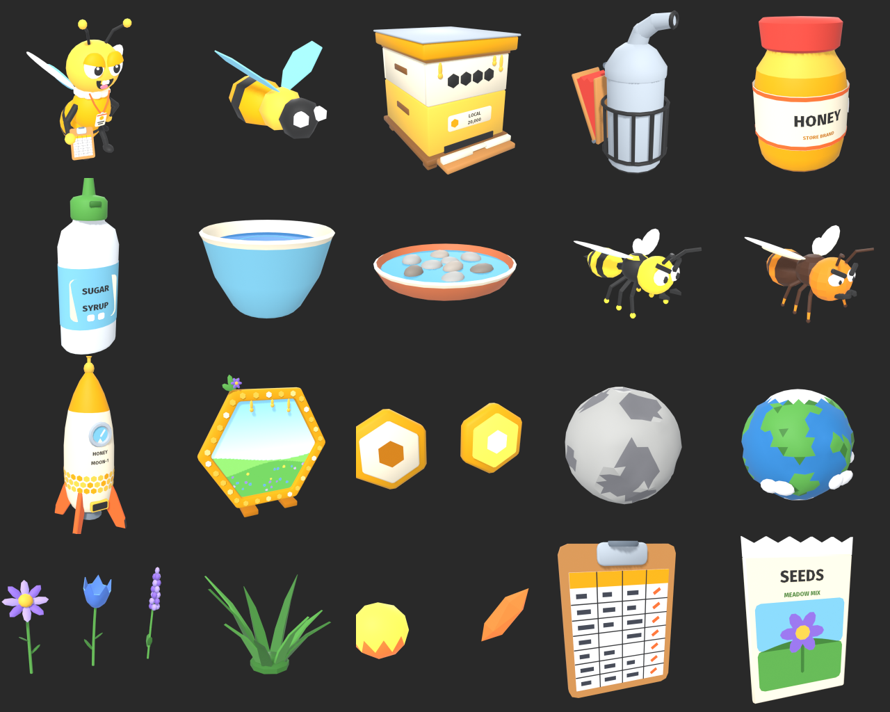

# Procedural stand-in art (Blender scripts)

Temporary low-poly art for every prop in the game, generated by Python scripts so anyone can rebuild, recolour or
reshape it in seconds. It is meant to look intentional (chunky, warm honey palette, slightly glowing bees), but it's
a stand-in: **dartiros, keep what works and replace the rest.** Names and pivots match the Unity placeholder, so a
hand-made model can take over a slot without code changes.



## What's here

| Item | Tris (budget) | Size W x H x D (m) | Pivot | Objects and anchors |
|---|---|---|---|---|
| beeswax | 6508 (15k) | 0.30 x 0.38 x 0.24 | body center (chest) | Beeswax > Body > Torso, Head, Eyes, Mouth, WingL, WingR, Lanyard, Clipboard, HandR, HandL; CaptionAnchor |
| worker_bee | 262 (300) | 0.03 x 0.02 x 0.035 | body center | WorkerBee (1 mesh, 1 material, vertex colours) |
| hive | 2599 (5k) | 0.39 x 0.45 x 0.51 | base | Hive > LiftRoot > Stand, BoxLower, BoxUpper, Lid, Door > DoorSlot, DoorPoint, SwarmCenter, Hexagons > HexSlot1-4, HeatGlow, EntranceReducer |
| smoker | 1512 (3k) | 0.12 x 0.27 x 0.19 | base | Smoker > Canister, Lid, Bellows, BellowsLever, SmokePoint |
| honey_jar | 1044 (3k) | 0.08 x 0.12 x 0.08 | base | HoneyJar > Jar, Lid, Label |
| syrup_bottle | 824 (3k) | 0.07 x 0.20 x 0.05 | base | SyrupBottle > Bottle, Cap, Label |
| deep_bowl | 750 (3k) | 0.17 x 0.11 x 0.17 | base | DeepBowl > Bowl, Water |
| pebble_dish | 1110 (3k) | 0.20 x 0.03 x 0.20 | base | PebbleDish > Dish, Water, Pebbles, LandingSpot1-9 |
| wasp | 1964 (3k) | 0.04 x 0.03 x 0.06 | body center | Wasp > Body, WingL, WingR |
| giant_hornet | 2658 (3k) | 0.25 x 0.17 x 0.33 | body center | GiantHornet > Body, Mandibles, WingL, WingR |
| rocket | 1871 (3k) | 0.21 x 0.60 x 0.21 (0.73 with the flame) | base (fin tips) | HONEYMOON-1 > Hull, Flame, Seat, Perch, CountdownDisplay |
| portal_frame | 2260 (3k) | 0.80 x 0.83 x 0.16 (0.94 wide with the halo) | base (feet) | PortalFrame > Frame, LivePane, FallbackPane, Glow, Embers |
| hexagon_tile | 312 (3k) | 0.04 x 0.04 x 0.01 each | back face center | HexTile > Face; HexTile_Lit > Face_Lit |
| moon | 1280 (3k) | 0.50 ball | center | Moon |
| earth | 2080 (3k) | 0.20 ball | center | Earth > Clouds |
| flowers | 2252 (3k) | ~0.12-0.17 tall | base of each stem | Flower_Purple, Flower_Blue, Flower_Lavender |
| grass_tuft | 296 (3k) | 0.10 x 0.08 x 0.11 | base | GrassTuft |
| ember | 100 (3k) | 1-2 cm | center | Ember, EmberFlake (+ `textures/ember.png` sprite) |
| clipboard | 772 (3k) | 0.09 x 0.12 | bottom edge center | Clipboard |
| seed_packet | 371 (3k) | 0.075 x 0.115 | base | SeedPacket |

The built files (`<item>.glb`, `<item>.fbx`, `blend/<item>.blend`, `previews/`, `stats.json`) live on pop-os in
`~/immerse-the-bay/art-staging/procedural/`. They aren't committed; rebuild them with the command below, which takes
~20 s for all 20 items.

## Run it

Needs Blender 4.2 or newer (built with 4.5.16 LTS). Headless, from this folder:

```bash
# everything: GLB + FBX + .blend + previews + stats, 6 Blender processes in parallel
blender -b --factory-startup --python scripts/build_all.py -- --out out

# a few items, no previews
blender -b --factory-startup --python scripts/build_all.py -- --out out --only beeswax,hive --no-render

# one item on its own
blender -b --factory-startup --python scripts/beeswax.py -- --out out

# check the exports: no rotated/scaled nodes, GLB and FBX import to the same place
blender -b --factory-startup --python scripts/check_exports.py -- --out out
```

On pop-os, Blender is at `~/.local/opt/blender-4.5.16-linux-x64/blender`.

Output in `out/`: `<item>.glb`, `<item>.fbx`, `blend/<item>.blend`, `previews/<item>.png` (2 x 2 turntable,
512 px, transparent) and `<item>_hero.png`, `previews/_contact_sheet.png`, `stats/<item>.json` (tris per object,
pivots in Unity space), `stats.json`, `textures/` and `logs/`.

## Conventions (match PLAN.md S11.1)

- **Meters, Y-up, +Z forward in Unity.** In Blender the front faces **-Y** and a character's left is **+X**. Both
  exporters land the front on Unity +Z.
- **Every node has zero rotation and unit scale.** An object's origin is its pivot. Props pivot at the base, bees and
  insects at the body center, the moon/earth/embers at their center, the hex tile at its back face.
- **Colour = vertex colour + palette UV.** Every face carries one palette key. The mesh gets it twice:
  - a vertex colour (`Col`, sRGB), for the project's `Honeymoon/Unlit` shader with `_UseVertexColor = 1`, which is
    what the swarm uses;
  - a UV into `textures/VBS_Palette.png` (64 x 64, 8 x 8 cells), so plain URP Lit, Simple Lit or Unlit with that
    texture also works. Set the texture to **Point filter**, and turn mip maps off (or accept a little bleed far away).

  The GLB uses only the palette texture (no COLOR_0), so glTF viewers and glTFast don't darken it twice.
- **Materials:** `VBS_Palette` (emission 0.08), `VBS_Palette_Bee` (emission 0.45, so the bees, wasps and hornet
  read in passthrough), `VBS_Glow` (flame, embers, the lit hex), `VBS_GlowSoft` (hive heat glow and portal halo, 35%
  alpha), `VBS_PaneLive` / `VBS_PaneFallback` (portal panes). They're named the same in every file, so you can remap
  each one to a single project material. The worker bee is one mesh with one submesh.
- **FBX:** Apply Scalings = FBX All (file units = meters), axis -Z forward / Y up, no axis-conversion rotations, and
  the palette texture is embedded. Don't tick Unity's "Bake Axis Conversion": it isn't needed.
- **Hidden in the previews only:** `HeatGlow`, `Flame`, `LivePane` and `Glow`. All of them are still in the exports.

## Slot notes for Unity

- **Beeswax:** `Mouth` pivots at its top edge, so scaling Y opens it downward (closed is about `(1, 0.25, 1)`,
  open `(1, 1.2, 1)`). `WingL`/`WingR` pivot at the wing root, so rotating them on Z flaps them. Point
  `dustyRenderers` at `Torso` and `Head`. Scale `Body` for the talk pulse.
- **Hive:** `Door` sits at the entrance. Its child `DoorSlot` is the dark slot, so scaling `Door` on X narrows the
  entrance. `EntranceReducer` is the separate wooden cleat, resting on the landing board. `Lid` pivots on its
  back-bottom edge: rotate it on X to open it, or move it up to lift it. `BoxUpper` is open at the top with frames and
  comb inside. `HexSlot1-4` mark where the four hexagon tiles go.
  **The placeholder scene has its hive door facing -Z, but this hive faces +Z like every other asset.** If the slot
  loader keeps the old orientation, rotate the prefab 180 degrees on Y.
- **Rocket:** `Flame` pivots at the nozzle exit and is meant to be hidden until launch. `CountdownDisplay` is an
  empty sitting just in front of the little screen: parent the countdown text to it.
- **Portal:** `LivePane` (in front) and `FallbackPane` (4 mm behind) are the same hexagon with real UVs. The hexagon
  shows the centered 65% of a 16:9 frame (u 0.175-0.825), so the video isn't stretched. `Embers` is at the pane
  center with +Z pointing out at the player. `FallbackPane` ships with a stand-in meadow picture
  (`textures/meadow_fallback.png`).
- **Pebble dish:** `LandingSpot1-9` sit on the pebble tops where the bees land to drink.

## Tweak it

- **Colours:** edit `PALETTE` at the top of `scripts/common.py` and rebuild. Every item using that key changes.
  Add new keys at the end so the existing palette cells keep their place. Glow strength is in `MATERIALS` just below.
- **Which colour goes where:** each script passes palette keys by name (`"amber"`, `"charcoal"`, ...). Stripe
  tables like `STRIPES` are at the top of the bee scripts, and the hive has a `COLORS` dict.
- **Proportions:** the main measurements are constants at the top of each script, for example `HEAD`, `EYE`,
  `LID_DROOP`, `MOUTH` and `WING` in `beeswax.py`; `W`, `D`, `LOWER_H`, `UPPER_H` and `ENTRANCE` in `hive.py`;
  `PROFILE` and `HEX_ROWS` in `rocket.py`; `R_OUT`/`R_IN` in `portal_frame.py`.
- **By hand:** open `blend/<item>.blend`, edit it, save it, then re-export it with the same settings:
  `blender -b out/blend/hive.blend --python scripts/export_open.py -- --out out`. If you export from the Blender
  UI instead, **don't tick FBX "Apply Transform"**. That option is Blender's experimental bake, and it rotates nested
  children 90 degrees (it broke the hive's and Beeswax's sub-parts). Without it the roots come in with -90 X, so tick
  "Bake Axis Conversion" in Unity. GLB from the UI is fine as is. The palette and vertex colours are already on the
  meshes.
- **Building blocks** (`common.py`): `MB` builds one mesh object from `sphere`, `ico`, `box`, `lathe`, `cyl`,
  `tube`, `limb`, `torus`, `poly` (an extruded outline), `hexprism`, `flat`, `ring`, `text` and `half_dome`. Each
  one takes a matrix `m`, a palette key (or a function `(face_center, normal) -> key`) and an optional bevel.
  `C.M(loc, rot_degrees, scale)` builds the matrix. `ellipsoid_decal`, `cyl_wrap` and `ellipse_wrap` wrap flat art
  (mouths, labels) onto curved surfaces.

Text is baked into the geometry using Fira Sans ExtraBold if it's installed, otherwise DejaVu Sans Bold, otherwise
Blender's built-in font, so no font files ship.

## Weak spots (replace these first)

- **smoker:** the bellows read as a book (two boards with red leather between them), and the can is pale. It's fine
  at a glance, but it's the least convincing prop.
- **giant_hornet:** the mandibles read a bit like a moustache. It's funny, but not very scary.
- **Small printed text** (the hive's LOCAL 20,000 plaque, the rocket's HONEYMOON-1, STORE BRAND on the jar) is
  geometry and readable up close, but don't rely on it at 1 m. The syrup bottle's SUGAR SYRUP and the jar's HONEY
  are the important ones, and they're big.
- **moon/earth:** deliberately faceted. If they fill the meadow window at T-0, the recorded Orbis clip will do more
  than these meshes.
